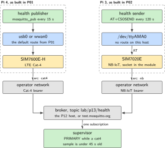
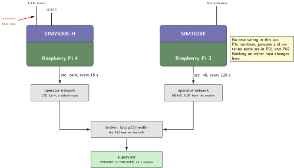
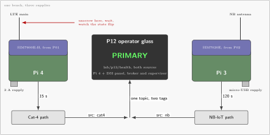
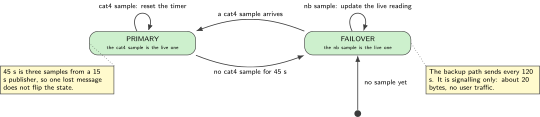

# P13. Dual-radio signalling failover

> **Host:** Pi 4 + SIM7600 and Pi 3 + SIM7020, with the P12 broker  
> **Owns:** multi-homing with a source tag

> [!NOTE]
> **Why this lab is unique**
>
> Owns multi-homing. Two Pis, two modems, one MQTT topic with a source tag. Not link bonding, and not a stacked-HAT fantasy.

## Intent

The Pi 4 with the SIM7600 is the primary path, reusing the P01 WAN exactly as it was built there. The Pi 3 with the SIM7020 is the backup signalling path, reusing P02 exactly as it was built there. A supervisor on the P12 broker watches one topic and marks the system PRIMARY or FAILOVER. Nothing is bonded, nothing is load balanced, and no kernel is asked to hold two default routes at once.

The word signalling is doing real work in that sentence. The backup path carries a health sample every two minutes, roughly twenty bytes at a time. It cannot carry the traffic of the primary path and it is not meant to. What it can do is tell an operator that the node is alive when the Cat-4 route has gone, which is the property this chapter is about.

> [!NOTE]
> **Kit from the bin**
>
> Pi 4 with the SIM7600 attachment from P01, Pi 3 with the SIM7020 attachment from P02, and the P12 broker if it is built, otherwise `test.mosquitto.org`.

> [!NOTE]
> **This lab has no wiring of its own**
>
> Every wire in this chapter was made in P01 and P02. The schematic below is a topology drawing, not a new attachment: for pin numbers, jumper positions and antenna ports, use the wiring tables in those two chapters. If either attachment is not yet passing its own acceptance test, finish that lab first.

## System architecture



*Figure 13.1. Two complete hosts, two radio paths, one topic. The supervisor is the only component that knows about both, and it knows about them only as tagged samples that arrive or fail to arrive.*

Each host is independent all the way down. The Pi 4 holds a default route on `usb0` or `wwan0` and publishes with a normal MQTT client over it. The Pi 3 holds no route at all: its sample leaves through a UDP socket inside the SIM7020E module, as built in P02, and reaches the same topic by whatever path P02 actually reached. Neither host knows that the other exists.

The supervisor holds the entire state of the system, and that state has one input: the arrival time of the most recent sample tagged `cat4`. This is the smallest arrangement that does the job, and its smallness is the point. A supervisor that also probes the radios, or reads modem status, or tries to bring an interface up, has made itself a second failure surface on top of the one it was meant to observe.

|  | Primary path | Backup path |
| --- | --- | --- |
| Host | Pi 4 | Pi 3 |
| Radio | SIM7600E-H, LTE Cat-4 | SIM7020E, NB-IoT |
| Built in | P01 | P02 |
| Route on the host | Default route on usb0 or wwan0 | None. The socket is inside the module |
| Transport used here | MQTT client over the WAN | UDP datagram from the module |
| Sample interval | 15 s | 120 s |
| Source tag | `cat4` | `nb` |
| What its loss means | The supervisor declares FAILOVER after 45 s | The node is unreachable by both paths |

*Table 13.1. The two paths, side by side. They are not equivalent and are not meant to be: one carries a route, the other carries a signal.*

## Wiring and schematic

The wiring is P01's and P02's. Nothing on either host changes for this lab, including the jumper positions, the antennas and the LEDs. What follows is the topology.



*Figure 13.2. The two-host topology. Two radios, two operator paths, one topic, one supervisor. The two hosts share no cable and no kernel, and the only thing they have in common is the string in the source tag.*

| Host | Attachment | Built in | Path used here |
| --- | --- | --- | --- |
| Pi 4 | SIM7600E-H HAT, LTE and GNSS antennas, ADXL345, LEDs on BCM 16/20/21 | P01, unchanged | Default route on usb0 or wwan0, a normal MQTT client |
| Pi 3 | SIM7020E HAT, NB antenna, green LED on BCM16 | P02, unchanged | UDP socket inside the module, no route on the host |
| Pi 4 with the DSI panel | Official touchscreen and keyboard, Mosquitto | P12, unchanged | Broker and supervisor, on the LAN |

*Table 13.2. The three attachments this lab borrows. It adds no wiring of its own, and it changes nothing on any of them.*

```text
No new wiring in this lab.

  Pi 4  + SIM7600E-H   ......  exactly as built in P01 (HAT, 2 antennas, USB cable)
  Pi 3  + SIM7020E     ......  exactly as built in P02 (HAT, NB antenna, UART jumper B)
  Pi 4  + DSI panel    ......  exactly as built in P12 (broker, keyboard, glass)

  The only physical action in this chapter is on an antenna connector:
    unscrew the LTE main antenna  -> the state must flip to FAILOVER
    refit the LTE main antenna    -> the state must return to PRIMARY
  Refit it before the next transmission. No antenna means no attach, and
  transmitting into an open port stresses the power amplifier.
```

> [!IMPORTANT]
> **Before the antenna comes off**
>
> Two hosts, two HATs, one per host. Do not stack the Explorer700 or a second modem on either Pi. Power off before unseating anything, and refit the LTE antenna as soon as the failover test is recorded.

## Bench layout



*Figure 13.3. Bench layout. Three boards, three supplies and one pair of hands on one antenna connector. The glass shows the supervisor state, so the operator can watch the transition while performing it.*

Put the two radio hosts far enough apart that their antennas are not touching, and put the operator glass where you can see it from the antenna. The transition takes up to 45 seconds, so the test is a slow one: unscrew, wait, watch the state change, refit, wait, watch it return. Write both times in the lab book.

Three supplies, three power switches and one topic. Label the two radio hosts on their cases before you start, because from across the bench a Pi 3 with a black HAT and a Pi 4 with a black HAT look identical, and this is the one lab where pulling the wrong antenna proves nothing.

## Software design (UML)



*Figure 13.4. The supervisor. Two states, one timer and one input. The 45 second window is three missed samples from a publisher that sends every 15 seconds, which is long enough to survive one lost message and short enough to notice a lost route.*

The supervisor is a subscriber with a clock. Every message on `lab/p13/health` carries a source tag. When the tag is `cat4` the arrival time is recorded. When the tag is `nb` the sample is kept as the latest backup reading. On every tick, if the most recent `cat4` sample is older than 45 seconds the state becomes FAILOVER and the `nb` sample is the live one, and when a `cat4` sample arrives again the state returns to PRIMARY.

## Data flow (ASCII)

```text
  Pi 4 + SIM7600 (P01)                          Pi 3 + SIM7020 (P02)
  +-------------------------+                   +-------------------------+
  | default route on usb0   |                   | no route on the host    |
  | mosquitto_pub every 15 s|                   | AT+CSOSEND every 120 s  |
  |   {"src":"cat4","ok":1} |                   |   {"src":"nb","ok":1}   |
  +-----------+-------------+                   +-----------+-------------+
              |  LTE Cat-4                                  |  NB-IoT
              v                                             v
      [ operator network ]                          [ operator network ]
              |                                             |
              +---------------------+-----------------------+
                                    v
                        topic  lab/p13/health
                                    |
                                    v
                    +-------------------------------+
                    | supervisor on the P12 broker  |
                    |   last cat4 sample < 45 s ?   |
                    |     yes -> PRIMARY            |
                    |     no  -> FAILOVER, nb live  |
                    +-------------------------------+
```

Read the diagram from the bottom. The supervisor sees one stream of tagged records and nothing else. It does not see two interfaces, it cannot see a route, and it has no opinion about radios. That is what makes the test at the end of this chapter meaningful: when the antenna comes off, the only thing that changes in the supervisor's world is that records with one tag stop arriving.

## Steps

**Step 1.** **Do not undress P01 and P02 on the same afternoon** if you still need their individual acceptance tests. This lab assumes both already attach. Confirm that first: `AT+CEREG?` on each host, and a default route on `usb0` on the Pi 4.

**Step 2.** **Publish the primary health sample from the Pi 4**, every 15 s, through the P01 WAN.

```bash
# on the Pi 4, through the P01 WAN
while true; do
    mosquitto_pub -h localhost -t lab/p13/health \
        -m '{"src":"cat4","ok":1}'
    sleep 15
done
```

The publisher is a loop and a command, and it stays that way. Keeping it dumb is the design: neither host detects the other's state or changes its own behaviour when the supervisor changes state, which is why all the intelligence sits in one place.

**Step 3.** **Publish the backup health sample from the Pi 3**, every 120 s, over CoAP/UDP or whatever P02 actually reached. The payload is the same record with a different tag, and it leaves through the module socket, not through a host route.

```text
AT+CSOC=1,2,1
AT+CSOCON=0,5683,"172.16.0.1"
# the record {"src":"nb","ok":1} as hex, length counted as in P02
AT+CSOSEND=0,38,"7B22737263223A226E62222C226F6B223A317D"
```

**Step 4.** **Run the supervisor** on the P12 broker host, or on a laptop on the same LAN. It is the `p13` directory of this repository, in C, and it reads what `mosquitto_sub -v` prints. It does not open a socket, subscribe to anything or know what a broker is.

```bash
make -C p13 && make -C p13 check
mosquitto_sub -h localhost -t lab/p13/health -v | \
    ./p13/p13 supervise --log bench.p13
```

Nothing in the state machine reads a clock. The time arrives as an argument, from a monotonic clock during a run and from a column of the log during a replay, and the machine cannot tell the difference. That is what makes the window testable at its own boundary rather than near it, and it is why the whole of this lab's behaviour can be exercised before either radio is switched on:

```bash
./p13/p13 scene --kind outage --out outage.p13   # a run that did not happen
./p13/p13 verify --source outage.p13             # judged as if it had
./p13/p13 scene --kind short-gap --out gap.p13   # one missed sample
./p13/p13 verify --source gap.p13                # refused: nothing fell
```

The second pair is the one worth running twice. A window of one sample would flip on a single missed record, and a reader who shortens the window to make the lab feel more responsive finds that out in the field rather than here.

**Step 5.** **Unscrew the LTE main antenna.** The state must flip to FAILOVER within 45 seconds of the last primary sample. Refit the antenna. The state must return to PRIMARY on the next primary sample. Record both transitions with their timestamps.

**Step 6.** **Record both sources to a file.** The log is the acceptance artifact, and it has to show both tags and the two transitions with their timestamps.

```bash
# the supervisor's own log is the machine readable half
./p13/p13 verify --source bench.p13
# and the human half, kept beside it
mosquitto_sub -h localhost -t 'lab/p13/health' -v | ts >> /var/log/lab-p13.txt
grep -c '"src":"cat4"' /var/log/lab-p13.txt
grep -c '"src":"nb"'   /var/log/lab-p13.txt
ip route | grep default        # on each host: one modem route, not two
```

`verify` prints one line per item of the acceptance test and exits non-zero if any of them is missing from the log, including the case nobody expects to fail: a log of a perfectly healthy run, in which no antenna was ever pulled, is refused because it demonstrates nothing.

**Step 7.** **Show the state on the glass.** A `watch` terminal on the P12 panel, or the dashboard page from that chapter, is enough. The operator should be able to read the state from across the bench without a keyboard.

**Step 8.** **Refit the antenna and confirm the return.** The test is not finished at the flip. Screw the LTE main antenna back on, wait for the next primary sample, and confirm that the state returns to PRIMARY on its own, with no restart of the supervisor and no intervention on either host.

## Acceptance test

- The antenna-pull test above: unscrew the LTE main antenna, the state flips to FAILOVER; refit it, the state returns to PRIMARY.
- Logs show both sources. A `cat4` record roughly every 15 s and an `nb` record roughly every 120 s, each with its tag intact.
- Never a bonded `metric 0` default route on one kernel. Check `ip route` on both hosts: the Pi 4 has one default route through the modem, and the Pi 3 has none through its modem at all.
- The transition is visible on the P12 glass without opening a terminal.
- The FAILOVER transition happens no later than 45 seconds after the last `cat4` record, and the return to PRIMARY happens on the first `cat4` record after the antenna is refitted.
- The backup publisher keeps its own rhythm through both transitions. Its interval does not change because the state changed, because the two are not connected.
- The LTE antenna is back on the connector at the end of the sitting, and the lab book says so.

## Practices

This is signalling failover. Do not advertise a 50 Mbit NB-IoT backup, it does not exist. The backup path carries a health record and nothing else, and any design that assumes otherwise will be found out on the first day it is needed.

- **Tag at the source, not at the broker.:** The string `cat4` or `nb` is written by the host that owns the radio. A tag added by the supervisor describes what the supervisor believed, which is the thing under test.
- **One timer, one state.:** The 45 second window is the only tunable in the supervisor. Resist adding a second timer for the backup path until the first one has been observed over a working day.
- **Keep the two publishers dumb.:** Neither host should try to detect the other's state or change its own behaviour when the supervisor changes state. All the intelligence in this design sits in one place, and that is why it can be read in twenty lines.
- **Refit the antenna.:** The teardown rule from the source applies here more than anywhere else, because this lab asks you to remove an antenna on purpose. Refit it before the next transmission.

## Pitfalls

- **Treating this as link bonding.** Two radios, two kernels, two independent paths. There is no interface that carries both, and no kernel is asked to choose between them.
- **A supervisor that probes.** If the supervisor pings the Pi 4, it is no longer measuring the uplink the publisher uses. Arrival of a tagged sample is the only evidence this design accepts.
- **A timeout shorter than the publish interval.** With a 15 second publisher, a 20 second window reports FAILOVER every time one message is lost. The 45 second window tolerates two.
- **A backup interval longer than the timeout, read as a fault.** The NB path sends every 120 seconds by design. A FAILOVER state may therefore be minutes old before the backup sample refreshes, and that is the honest behaviour of this path, not a defect.
- **One SIM in both hosts, swapped between tests.** The two paths have to be live at the same time for the test to mean anything. Two SIMs, two radios, two hosts.
- **Both scripts publishing from the same host.** It proves nothing. The test needs two hosts, because the failure being modelled is the loss of one host's radio.
- **Undressing P01 or P02 first.** If either attachment is broken down, the lab starts with two unproven radios and one unproven supervisor, and the first failure will be ambiguous.
- **Leaving the antenna off.** Transmitting into an open port stresses the power amplifier. Refit it as soon as the transition is recorded.
- **Publishing both tags with one client identifier.** If both hosts reach the broker with the same client identifier, the broker will keep dropping one of the sessions and the log will look like a radio problem.
- **A supervisor clock that is not the broker's.** If the supervisor runs on a laptop that sleeps, the 45 second window measures the laptop's suspend behaviour rather than the radio. Run it on the P12 host.
- **Declaring success on the first flip.** The interesting half of the test is the return to PRIMARY. A supervisor with a latch, or with an uninitialised timer, will flip once and stay flipped.

## Sources

- P01 in this volume, for the Cat-4 attachment, the WAN and the LED conventions this lab reuses unchanged
- P02 in this volume, for the NB-IoT attachment and the module socket this lab reuses unchanged
- P12 in this volume, for the broker, the panel and the operator glass the supervisor runs on
- Eclipse Mosquitto documentation, broker configuration and `mosquitto_pub`, <https://mosquitto.org/documentation/>
- Eclipse Mosquitto, for `mosquitto_pub` and `mosquitto_sub`, <https://mosquitto.org/man/>
- SIMCom SIM7600 and SIM7020 AT command manuals, for `AT+CEREG?` and `AT+CSOSEND` (module vendor documentation)
- The lab sequence at the end of this volume, which places this chapter after P01, P03 and P02 for exactly this reason
- The operator's own coverage notes for both SIMs, since a backup path that shares one cell with the primary is not a backup

---

[Previous](12-official-dsi-operator-glass-and-mqtt-broker.md) &nbsp;&nbsp;|&nbsp;&nbsp; [Contents](../README.md) &nbsp;&nbsp;|&nbsp;&nbsp; [Next](14-usb-ttl-provisioning-jig.md)
