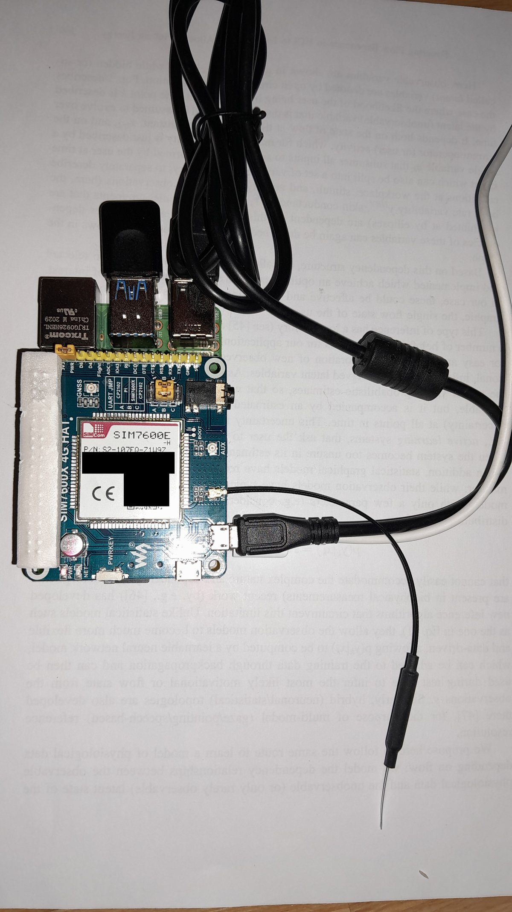

# P01: the claim that moved three pins, and its withdrawal

The lab is [LTE Cat-4 motion-triggered gateway](../chapters/01-lte-cat-4-motion-triggered-gateway.md).
This is the record of the most expensive error in the volume, because the claim
was load-bearing: it was the only stated reason three indicator pins ever moved.

## What was believed, and for how long

An early draft put three status indicators on header pins 13, 15 and 16, which
are BCM GPIO27, GPIO22 and GPIO23. The chapter then recorded that on the
SIM7600E-H those three are the modem's own control lines, ring indicator, data
terminal ready and clear to send, so hanging an LED on any of them would put a
second driver on a line already in use. The stated consequence was memorable:
not a dark LED, but a modem behaving oddly for reasons nothing in the log
explains.

That reasoning is sound. The premise was false. The claim stood from the first
draft until **Thursday 8 October 2026**, and in that time it propagated into
three other files.

## How it came apart

**Monday 5 October 2026.** The HAT's user manual, revision 1.0 of June 2018, was
read end to end for the first time. Its Table 1 is captioned as the relationship
between the module's control pins and Raspberry Pi IOs, and it lists six rows:
5 V, ground, the module's TXD to BCM GPIO15, its RXD to BCM GPIO14, PWR, and
flight mode. **RI, DTR and CTS are not among them.**

That was not treated as a refutation, and the distinction mattered. One document
failing to mention something supports "not documented", never "not connected".
The claim was marked **open** rather than withdrawn, and the entry said what
would settle it.

**Thursday 8 October 2026.** The carrier schematic settled it. `P27`, `P22` and
`P23` appear only on the Raspberry Pi header symbol, with no net leaving the
header, no path to the module, the level translator, the USB bridge or either
jumper, and no pull on the board. That is positive evidence of non-connection,
which is what a withdrawal requires and a missing table row does not supply.

The vendor's own wiki confirmed the same six-line connection table independently.

## What follows, including the uncomfortable part

**The pins were free the whole time, so the migration was never necessary.** The
chapter says so rather than quietly keeping the new pins, because a reader who
finds the volume using pins 36, 38 and 40 deserves to know whether the original
three were dangerous or merely abandoned.

Of the three reasons this volume has given for moving those indicators, two are
now withdrawn and one stands:

| Reason given | Verdict |
|---|---|
| The SIM7600E-H drives GPIO27, GPIO22, GPIO23 | **False.** Header pass-through only |
| The SIM7020E claims GPIO27 for its power key | **False.** It is on GPIO4, see [p02](p02.md) |
| The MCC 118 claims BCM26 | **True**, and the only real one |

The wiring did not move back, and that is a decision rather than inertia. BCM16,
20 and 21 are documented free on every board in the bin, one assignment safe
across four cellular labs is easier to hold than four, and reverting would be a
second unnecessary migration undoing the first. What changed is a justification,
not a wire.

## What the same reading gave that was not an error

Reading the manual and the wiki properly also produced three facts the volume
simply did not have, and two of them correct a sentence that was written in
confidence:

**This board also has a 3.3 V and 5 V VCCIO jumper.** The chapters had named that
hazard on two modem HATs. It is on all three. Confirm it sits on 3.3 V before
power, every time.

**The 3.3 V header pin is attached unconditionally.** VCCIO is soldered to 3.3 V
and that rail is the high side of the level translator, so this HAT draws on the
Pi's 3.3 V rail whatever else is configured. That belongs in a power budget and
was nowhere in the book.

**The two UART lines are jumper-dependent.** Only position B puts the Pi on the
module; A puts the onboard USB bridge on the Pi's console and C puts it on the
module, and in both of those GPIO14 and GPIO15 are not on the SIM7600 at all.
The manual never states the factory position, so it is a bench check rather than
an assumption. The chapter's steps block had `UART = B` right all along while its
prose was wrong, which is a split worth closing wherever it appears.

**Three antenna connectors, not two.** MAIN, AUX and GNSS.

## The trap worth carrying to any other board

The silkscreen naming on this board changed from wiringPi to BCM. On the older
sheet `P4` means BCM GPIO4 and not GPIO23, and `P22` means BCM GPIO6 and not
GPIO25. A reader who takes those as physical pin numbers wires a modem's power
key to the wrong conductor. This is why every pin in this volume is written as
header pin and BCM number together, always, even when it reads as padding.

## Monday 20 October 2026: the modem seated, the SIM registered

The first time this lab's hardware was on a bench, and the first time any
modem in this volume has answered an AT command. It took most of an afternoon
and the modem was the last thing in the chain to be at fault.

**The host.** Raspberry Pi 4 Model B Rev 1.4, hostname `eplepi`, kernel
`6.18.50+rpt-rpi-v8`, and `/etc/os-release` reads
`PRETTY_NAME="Debian GNU/Linux 13 (trixie)"`. The chapter puts this lab on
the Pi 4 and that is where it was.

**The HAT.** SIM7600E-H, module revision `SIM7600M22_V1.1`, firmware
`LE11B13SIM7600M22`, LTE antenna on the main port, GNSS port empty. Its own
micro-USB to a Pi USB-A socket, which is the cable the chapter names and the
thing that carries the AT channel. It enumerated on the first try as
`1e0e:9001 SimTech`, the `option` driver attached `ttyUSB0` to `ttyUSB4`,
and `qmi_wwan` registered `wwan0` and `cdc-wdm0`. Device number 4 at boot
and never re-enumerated after. `vcgencmd get_throttled` read `0x0`, so the
HAT was not browning the Pi out. ModemManager was inactive, so nothing
competed for the ports.

*Photograph taken Monday 20 October 2026. The serial number, the IMEI and
the QR code on the module label are blacked out; they identify the device
and have no place in a public tree.*

**The AT port** was `/dev/ttyUSB2`, which is the one the chapter names, and
the chapter's own five commands were the ones typed. `minicom` was not on the
board when the sitting began and was installed during it.

**The SIM.** An Elisa Finnish prepaid, and it carried a PIN: `AT+CPIN?`
answered `+CPIN: SIM PIN`, and until the PIN went in `AT+CEREG?` answered
`0,4`, unknown, which is what a locked SIM looks like from the registration
side. After `AT+CPIN="..."`: `+CPIN: READY`, `SMS DONE`, `PB DONE`, and then:

    AT+CSQ      +CSQ: 26,99
    AT+CEREG?   +CEREG: 0,5
    AT+COPS?    +COPS: 0,0,"Magenta-T- Saunalahti",7
    AT+CPSI?    +CPSI: LTE,Online,232-03,0x36BC,19653387,344,EUTRAN-BAND3,1300,5,5,-183,-990,-607,13

**Registered, roaming, on Magenta Austria, PLMN 232-03, LTE, Band 3.**
Signal 26 of 31. The two readings cross-check: `+CSQ: 26` converts to about
minus 61 dBm, and the RSSI field of `+CPSI` reads `-607`, which is minus
60.7 dBm in that line's tenths. The "Saunalahti" in the operator string is
the SIM's own home brand shown beside the visited network.

That settles the half of the SIM question this HAT can settle: the prepaid
carries ordinary LTE in Austria. The other half, NB-IoT and Cat-M, still
belongs to the SIM7070G.

## What the afternoon was actually spent on

Not the modem. In order:

**A micro-USB cable on the SIM7070G that enumerated and dropped.** The first
HAT tried was the SIM7070G, because it alone can answer both bearer
questions. Its `PWR` was lit and its `NET` blinked, so the module was
running, and nothing appeared on USB. After the cable was moved to a Pi
socket that a USB wifi adapter had just proved good, the kernel printed
`option1 ttyUSB5: GSM modem (1-port) converter`, then
`usb 1-1-port4: Cannot enable. Maybe the USB cable is bad?`, then
re-enumerated as device number 10. So that whole chain works and something
in it is intermittent. Whether it is the cable or the HAT's connector is not
known, because the SIM7600E-H then came up stable and I did not record
whether it was the same cable.

**Two changes to this board's `config.txt`, through `raspi-config`.** The
serial login shell was disabled and the serial hardware left enabled, so the
UART on GPIO14 and GPIO15 is free for a HAT and `/dev/serial0` now points at
`ttyS0`; and the 1-Wire interface was disabled, which removed
`dtoverlay=w1-gpio`. That overlay had no `gpiopin=` and so sat on GPIO4,
which is `PWRKEY` on every modem HAT in this bin, and the 1-Wire master had
registered sixty-four phantom slaves with family code `00` on it. It was not
what blocked anything, because the SIM7070G started regardless, but it had
no business on that pin. Both files were backed up first as
`*.before-uart-2026-10-20`. The UART route was prepared and never tested,
because the HAT was swapped before the pinmux check ran.

**Three mistakes of mine before any of that.** A console labelled with a
prompt that does not exist on this bench. A `minicom` command handed over
because the chapter prints it, without checking the board had it. And the
chapter's own step 1 skipped, the one that says the HAT needs its separate
USB cable before any device node appears. Each cost a round trip, and each is
written into the catalogue's notes so it is not paid for twice.

## What this moves and what it does not

`STATUS.md` moves P01 to **run**: hardware on the named host, the board
revision and kernel written down, AT bring-up done with the chapter's own
commands, registration achieved. None of its four acceptance items is met
yet. The first wants the ADXL345 on a soldered header. The second and third
want the data path, which on this board is `wwan0` through QMI rather than
the `usb0` the chapter leads with, and the chapter already covers that case.
The fourth wants sky.

## Monday 20 October 2026, later: the SIM7070G's socket, and a sentence above withdrawn

The paragraph above says it is not known whether the SIM7070G's drop-outs
were the cable or the HAT's connector. Two things arrived after it was
written, and together they settle it as far as a report can.

**The kernel's record of the SIM7070G, 14:59.** It identifies on USB as
`1e0e:9206`, product string `SimTech SIM7080`, serial `1234567890ABCDEF`,
which is a placeholder in the same way the SIM7600E-H's `0123456789ABCDEF`
is. Six `option` ports, `ttyUSB0` to `ttyUSB5`, and no `qmi_wwan`. It
attached at 14:59:07 and was gone at 14:59:17; back at 14:59:19, gone at
14:59:20; back at 14:59:23: device numbers 47, 48 and 49 in sixteen
seconds, with `throttled=0x0` so the Pi's supply was not the cause, and
ModemManager inactive so nothing was closing the port. A module that
enumerates every time and holds for one to ten seconds is a module with a
good data pair and a bad contact.

**Joseph's report:** the HAT's USB socket is broken. That is a physical
finding I did not have when the paragraph above was written, and it is
recorded here as his report rather than as a measurement, because the one
check that would make it one has not been run: the SIM7600E-H's cable,
proven stable on port `1-1.4` at 15:01, into the SIM7070G's socket. If it
cycles on that cable too, the socket is the object.

**What it closes and what it leaves.** The USB route to the SIM7070G is
closed. The HAT's documented route to a Pi was never that socket anyway: the
chapter says the HAT puts the module's UART on GPIO14 and GPIO15, and
`raspi-config` freed exactly those pins on `eplepi` this afternoon, so
`/dev/serial0` now points at `ttyS0` and the NB-IoT and Cat-M half of the SIM
question still has a route. It is untested. The chapter's hand-over prints
`/dev/ttyUSB2` and on that route would want `/dev/serial0`; noted, not
changed, because the route has not been run.

The SIM7600E-H stays seated. Its result stands and it is the HAT that works.

## Monday 20 October 2026, 15:43 to 16:10: the data path, items 2 and 3 met

The second sitting of the day on the same HAT, and the first acceptance
items in this lab to be met on hardware. In order, with the one thing that
cost time named.

**What the board had.** NetworkManager 1.52.1 active; no ModemManager. The
chapter's QMI step says to install it, so `modemmanager 1.24.0` went on
with `libqmi 1.36.0` and `libmbim 1.32.0`, at 15:43.

**Three scans found no modem.** The line that explained it, at 15:50:50,
read `couldn't create modem for device '...1-1.4': Failed to find a net
port in the QMI modem`, and three lines above it in every scan,
`port wwan0 not candidate`. ModemManager's udev rules tag the ports it may
use, and they had been installed after the modem enumerated, so the devices
already present carried no tag. `udevadm trigger --action=add` on `tty` and
`usbmisc` fixed the serial and QMI ports, and the scan then showed what the
probe had learned: `cdc-wdm0` QMI-capable with twenty-one services,
`ttyUSB2` the primary AT port, which is the one the chapter names, `ttyUSB3`
secondary AT, `ttyUSB1` GPS, `ttyUSB4` audio, `ttyUSB0` ignored by the
simtech plugin. A third trigger on `net` tagged `wwan0`, and the modem
appeared as `Modem/3`, the index counting the failed attempts. A reboot
would have done the same thing the long way.

**The modem's own view, before any PIN was typed this sitting:**
`state: registered`, `packet service state: attached`, signal 73 percent,
operator `T-Mobile A` at PLMN 23203, which is Magenta under its earlier
name. The only lock listed was `sim-pin2`, the fixed-dialling PIN that data
never touches. The SIM PIN had been entered in the minicom sitting and the
HAT was never powered down since; the Pi's reboot at 15:09 did not cut its
USB ports, so the module still held it. Worth knowing, because a bench
where the HAT is on the Pi's USB survives a Pi reboot with the SIM unlocked,
and a bench where it is on its own supply does not.
`initial bearer apn: CMNET` is SIMCom's factory default, not anything the
network gave; the APN used was `internet`, Elisa's published one.

**The lines that met the items**, on this OS's own stack, since the chapter's
QMI step stops at `mmcli -L`:

    sudo nmcli connection add type gsm ifname '*' con-name elisa-lte apn internet
    sudo nmcli connection up elisa-lte
    ip -4 addr show wwan0
    ping -I wwan0 -c 4 8.8.8.8
    sudo nmcli connection modify elisa-lte ipv4.route-metric 50
    sudo nmcli connection up elisa-lte
    ip route | grep default
    sudo nmcli connection down elisa-lte

`wwan0` came up `10.83.3.195/29`, a carrier-grade private address behind the
operator's NAT, gateway `10.83.3.196`. Four of four replies from `8.8.8.8`,
88 to 182 ms, TTL 118. NetworkManager gives a gsm connection metric 700,
below wifi at 600, so item 3 needed the metric set; at 50 the route table
read `default via 10.83.3.196 dev wwan0 proto static metric 50` ahead of
`wlan0`. The SSH session over `wlan0` survived it, as it should: the LAN is
a connected route, not the default. The connection was taken down at the end
so the prepaid stops carrying the board's background traffic; it stays
defined, and `sudo nmcli connection up elisa-lte` brings it back.

**Item 2 met. Item 3 met.** Monday 20 October 2026. Item 1 wants the
ADXL345 on a soldered header and item 4 wants sky; P01 stays at **run**.

**Two things the chapter will take, not yet changed.** Its QMI step ends at
`mmcli -L`, and the eight lines above are what comes after it on this OS,
plus the udev trigger for a ModemManager installed after the modem. And
ModemManager now owns `ttyUSB2` at boot: the chapter's `minicom` step will
contest it, and `sudo systemctl stop ModemManager` first is the way to type
AT commands again on this board.

## Monday 20 October 2026, 15:54: what the module says about its own bearers

A third sitting on the same HAT, in minicom on `/dev/ttyUSB2`, to let the
module answer three questions rather than have them answered for it. Each
command was run twice and both runs agreed.

**The module refuses the Cat-M and NB-IoT selector.** `AT+CMNB=?` answered
`ERROR`, twice. Not an empty list, not a value out of range: the command
does not exist on this firmware. So the claim that the SIM7600E-H is a
conventional LTE module and cannot answer the Cat-M or NB-IoT half of the
SIM question is now the module's own answer and not an inference from a
product page. `AT+CNMP=?` does answer, with
`(2,9,10,13,14,19,22,38,39,48,54,59,60,63,67)`.

**That has a consequence for P03, and it is a trap worth naming.** P03's
chapter prints `AT+CNMP=38` then `AT+CMNB=1` as the pair that locks the
SIM7070G to Cat-M. The number 38 is in this module's list too, and this
module has no `CMNB` at all, so the same number cannot mean the same thing
on both. What each value in that list means on this module is a question for
the SIM7600 series AT manual, which is a different document from the SIM7070
one P03 cites; this bench has not read it, and the journal is not going to
guess. What the bench does establish is narrower and enough: **P03's command
pair is specific to the SIM7070 family and must not be run against a
SIM7600E-H**, where the second half is refused outright and the first half
is a mode number from another table.

**The GNSS path answers and has no fix.** `AT+CGPS=1` returned `OK`,
`AT+CGPSINFO` returned `+CGPSINFO: ,,,,,,,,`, and `AT+CGPS=0` turned it off
again. Nine empty fields is the indoor result, and it is the one P01's
fourth acceptance item predicts: the subsystem is alive, the antenna port
for it is empty, and the lab is indoors. Item 4 stays open and now stays
open for the stated reason rather than for an untested one.

**The AT view of the PDP contexts is not the QMI view.** With `wwan0` having
carried traffic an hour earlier on APN `internet`, `AT+CGDCONT?` reads:

    +CGDCONT: 1,"IP","CMNET","0.0.0.0",0,0,0,0
    +CGDCONT: 2,"IPV4V6","ims","0.0.0.0.0.0.0.0.0.0.0.0.0.0.0.0",0,0,0,0
    +CGDCONT: 3

`internet` appears nowhere. Context 1 still holds SIMCom's factory `CMNET`,
context 2 is the operator's IMS context, and context 3 is bare. So the QMI
data path sets its APN through the WDS service and does not write the
AT-visible context table, and reading `AT+CGDCONT?` to find out what a QMI
bearer is using answers the wrong question. The chapter prints `AT+CGDCONT?`
in its AT bring-up list, which is fine as a look at what the module was
shipped with, and is not a check on the lab's own data path.

**One observation, recorded as an observation.** The cell moved between
sittings. At 14:xx: `EUTRAN-BAND3`, EARFCN 1300, cell 19653387. At 15:54:
`EUTRAN-BAND1`, EARFCN 325, cell 19653407 and 19653408 across the two runs.
Same operator and same tracking area, `232-03` and `0x36BC`, and RSSI around
minus 65 dBm against minus 60 before. A modem reparking on another band of
the same network between sittings is ordinary, and nothing here says why
this one did; it is written down because a band number that changes under a
lab is worth having in the record before someone treats one reading as the
bench's band.

## Monday 20 October 2026, 23:37: the registration reproduced on the other interface

This afternoon's result came through the module's USB interface, on
`ttyUSB2`. Tonight the same module answered on its **UART**, through the
40-pin header on `/dev/serial0` at 115200, with no USB cable attached at
all. Same module, different path, six hours apart.

    ATI         Model: SIMCOM_SIM7600E-H, Revision: SIM7600M22_V1.1
    AT+CPIN?    +CPIN: READY        (after the PIN, then SMS DONE, PB DONE)
    AT+CSQ      +CSQ: 24,99
    AT+COPS?    +COPS: 0,0,"Magenta-T- Saunalahti",7
    AT+CEREG?   +CEREG: 0,5
    AT+CPSI?    +CPSI: LTE,Online,232-03,0x36BC,19653387,344,EUTRAN-BAND3,1300,5,5,-158,-1030,-683,12
    AT+IPR?     +IPR: 115200

**Everything that should agree, agrees.** The model and firmware revision are
the ones recorded from the USB sitting. `+CEREG: 0,5` is reproduced,
registered and roaming. The operator string and access technology 7 are
unchanged.

**And the cell is the same cell.** PLMN `232-03`, tracking area `0x36BC`,
cell `19653387`, `EUTRAN-BAND3`, EARFCN 1300: identical to the 14:xx
reading, field for field. The band-1 excursion seen at 15:54, EARFCN 325 on
cell 19653407, was therefore transient and the module has come back. That
retires the open question in the earlier entry about treating one band
reading as the bench's band: it moves and it returns, so any band statement
in this volume needs its timestamp.

**Signal, for the record rather than for a conclusion.** `+CSQ: 24` against
26 this afternoon, and the `+CPSI` RSSI field reading -683 against -607,
which is minus 68.3 dBm against minus 60.7. Both readings agree with each
other, and the drop between sittings is the kind of thing a different
antenna position explains; nothing here identifies the cause.

**One new fact, and it has a cost attached.** `+IPR: 115200` means this
module's UART rate is **pinned and does not autobaud**. P01's chapter tells
the reader to open minicom at 115200, which is therefore right, and it
should say why. The cost is that every five-rate sweep run tonight, on both
boards, had exactly one rate that could ever have answered. Four fifths of
that work was spent for nothing, and a single `AT+IPR?` on a working
interface would have said so first.
